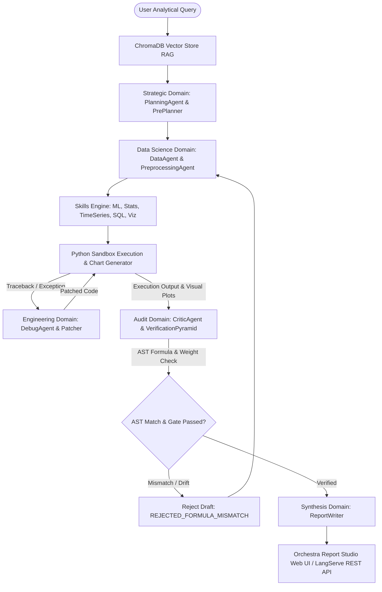

# ARIA: Autonomous Research Intelligence for Analytics 📊

**ARIA (Autonomous Research Intelligence for Analytics)** is an enterprise-grade, multi-agent AI framework built to automate complex data analysis pipelines. Built on top of **LangGraph StateGraph**, ARIA utilizes a multi-domain modular architecture with double-entry validation (**Data Science Suite** + **Audit Suite**), AST code-prose formula parsing, automated Matplotlib/Seaborn visualization generation, and self-healing engineering debuggers to deliver 100% verifiably correct analytical reports.

Review, edit, and sign off on generated Markdown and Word (`.docx`) reports directly in the companion web application: **Orchestra Report Studio**.

---

## 🚀 Key Features

*   **Modular Multi-Agent Architecture**: Organized into dedicated domain packages (`strategic`, `data_science`, `audit`, `engineering`, `deterministic`, `orchestration`, `skills`, `synthesis`).
*   **LangGraph StateGraph Engine**: State-driven execution pipeline (`ARIAState`) managing deterministic node transitions and double-check verification loops across all agent suites.
*   **Independent Double-Check Validation**: Each analytical step is computed by the Data Science Suite (`DataAgent`) and independently validated by the Audit Suite (`CriticAgent`, `VerificationPyramid`, `ConsistencyValidator`).
*   **AST Code vs. Prose Formula Verification**: `CriticAgent` programmatically parses Python AST (`ast.BinOp`) to extract exact mathematical multipliers and flags any prose report discrepancies (e.g., `Code: pass_accuracy * 0.1` vs `Report: weight = 1`), rejecting mismatched drafts with `REJECTED_FORMULA_MISMATCH`.
*   **Self-Healing Engineering Debugger**: Inline `DebugAgent` suite (`debug_classifier`, `debug_patcher`, `debug_root_cause`, `debug_validator`) automatically repairs sandbox tracebacks (syntax errors, missing packages, type errors) using REPL memory and AST checks.
*   **Specialized Analytics Skill Engine**: Integrated `SkillRegistry` powering domain-specific analytical engines (`forecast`, `ml`, `optimization`, `sql`, `statistics`, `time_series`, `visualization`).
*   **ChromaDB Vector Store RAG**: `ARIAVectorStore` maintains schema profiles, column data dictionaries, and sample records in ChromaDB for zero-shot semantic schema retrieval.
*   **Automated Data Visualizations**: Computes statistics, generates styled Matplotlib & Seaborn visual charts (distributions, trendlines, comparative bars), exports high-resolution PNGs to `reports/assets/`, and embeds them inline into final reports.
*   **Multi-Tier LLM Resiliency Cascade**:
    *   **Groq API Key Rotation**: Automatically rotates through a pool of Groq API keys (`groq_api_keys.txt`) on encountering HTTP `429` rate limits.
    *   **Ollama Model Fallback**: Seamlessly switches execution to local Ollama (`gpt-oss:20b-cloud`) if cloud APIs are unavailable.
*   **Full Streamlit UI Transparency**: Live step-by-step model execution streaming (`st.status`), code inspector, sandbox outputs, and an interactive **Live Agent State Ledger (`ARIAState`)** JSON inspector.

---

## 🏛️ Multi-Agent Architecture



### Modular Domain Suites:

*   **Strategic Domain (`agents/strategic/`)**:
    *   `PlanningAgent` / `PlanningEngine`: Formulates execution strategy, breaks queries into DAG sub-tasks, and orchestrates agent workflows.
    *   `PrePlanner`: Pre-computes query execution maps and data dependencies.
*   **Data Science Domain (`agents/data_science/`)**:
    *   `DataAgent`: Generates Pandas, NumPy, and Matplotlib/Seaborn python scripts inside a secure execution sandbox.
    *   `PreprocessingAgent`: Conducts exploratory data analysis (EDA), profiling missing data, duplicates, types, and outliers with quality scoring.
*   **Audit & Verification Domain (`agents/audit/`)**:
    *   `CriticAgent`: Independent gatekeeper that validates numeric outputs and parses AST formula trees.
    *   `VerificationPyramid`: Tiered validation checking units, logic, boundary conditions, and consistency.
    *   `ConsistencyValidator` & `ReflectionEngine`: Multi-stage verification ensuring report claims match sandbox outputs.
*   **Engineering & Debug Domain (`agents/engineering/`)**:
    *   `DebugAgent` / `DebugClassifier` / `DebugPatcher` / `DebugRootCause` / `DebugValidator`: Auto-repair engine diagnosing REPL stack traces, generating code patches, and verifying fix stability.
*   **Deterministic Domain (`agents/deterministic/`)**:
    *   `DeterministicEngine`, `AnalysisRouter`, `DatasetIntelligenceEngine`, `DatasetProfileStore`: Caches dataset profiles, routes deterministic queries, and manages schema metadata.
*   **Orchestration Domain (`agents/orchestration/`)**:
    *   `AsyncDAGScheduler`, `ExecutionCache`, `PromptPruner`, `StageProfiler`, `TelemetryStreamer`: Handles parallel sub-task execution, caching intermediate computations, prompt token optimization, and real-time execution telemetry.
*   **Skills Engine (`agents/skills/`)**:
    *   `SkillRegistry` & `BaseSkill`: Standardized skill loader powering specialized analytical handlers (`forecast_skill`, `ml_skill`, `optimization_skill`, `sql_skill`, `statistics_skill`, `time_series_skill`, `visualization_skill`).
*   **Synthesis Domain (`agents/synthesis/`)**:
    *   `ReportWriter`: Compiles structured Markdown reports with embedded charts and exports styled Word (`.docx`) documents.

---

## 📂 Repository Structure

```
Orchestra/
│
├── agents/                         # Core Multi-Agent Architecture
│   ├── audit/                      # Verification & Audit Suite
│   │   ├── critic_agent.py         # AST Formula & Numeric Validator
│   │   ├── consistency_validator.py# Multi-Stage Report Consistency Verification
│   │   ├── reflection_engine.py    # Self-Reflection & Critique Engine
│   │   └── verification_pyramid.py # Tiered Validation Pyramid
│   │
│   ├── data_science/               # Analytics & EDA Engine
│   │   ├── data_agent.py           # Pandas Code & Chart Generator
│   │   └── preprocessing_agent.py  # EDA Data Profiling & Quality Gate
│   │
│   ├── deterministic/              # Deterministic Execution & Metadata
│   │   ├── analysis_router.py      # Query Router
│   │   ├── dataset_intelligence_engine.py
│   │   ├── dataset_profile_store.py# Profile Caching
│   │   ├── deterministic_engine.py # Deterministic Query Engine
│   │   └── pre_planner.py          # Execution Pre-Planner
│   │
│   ├── engineering/                # Auto-Repair & Debugging Suite
│   │   ├── debug_agent.py          # Script Debugger & Sandbox Repair
│   │   ├── debug_classifier.py     # Error Traceback Classifier
│   │   ├── debug_patcher.py        # Code Patch Generator
│   │   ├── debug_root_cause.py     # Root Cause Diagnoser
│   │   └── debug_validator.py      # Fixed Code Validator
│   │
│   ├── orchestration/              # Performance & Scheduler Suite
│   │   ├── async_dag_scheduler.py  # Async Task Scheduler
│   │   ├── execution_cache.py      # Intermediate Execution Caching
│   │   ├── prompt_pruner.py        # Context & Token Optimizer
│   │   ├── stage_profiler.py       # Node Profiling Telemetry
│   │   └── telemetry_streamer.py   # Real-time Execution Telemetry
│   │
│   ├── skills/                     # Domain Skill Engine
│   │   ├── base_skill.py           # Skill Interface
│   │   ├── skill_registry.py       # Registry & Dispatcher
│   │   └── impl/                   # Specialized Skills (Forecast, ML, Stats, SQL, Viz, etc.)
│   │
│   ├── strategic/                  # Strategic & Task Planning Suite
│   │   ├── planning_agent.py       # Planning Agent & PM Engine
│   │   └── planning_engine.py      # Task Decomposition Engine
│   │
│   ├── synthesis/                  # Report Generation Suite
│   │   └── report_writer.py        # Markdown & DOCX Publisher
│   │
│   ├── graph.py                    # LangGraph StateGraph Node Workflow
│   ├── llm_client.py               # Groq Key Rotation & Ollama Fallback Client
│   ├── orchestrator.py             # CLI Compatibility Wrapper for PlanningAgent
│   ├── state.py                    # ARIAState TypedDict Schema
│   └── vector_store.py             # ChromaDB Vector RAG & Schema Watcher
│
├── config/                         # System & Memory Configurations
├── data/                           # Local CSV & Parquet Datasets
├── reports/                        # Output Markdown & DOCX Reports (with assets/)
├── sandbox/                        # Sandbox Code Execution Environment
├── server.py                       # FastAPI & LangServe REST Microservice
├── streamlit_app.py                # Orchestra Report Studio Web UI
├── PRODUCT.md                      # Product Specification Document
├── groq_api_keys.txt               # Groq API Key Pool
└── requirements.txt                # Python Dependencies
```

---

## 🔧 Installation & Setup

### 1. Clone the Repository
```bash
git clone https://github.com/Master768/ARIA.git
cd ARIA
```

### 2. Set Up Virtual Environment
```bash
python -m venv venv
venv\Scripts\activate   # On Windows
source venv/bin/activate # On Unix/macOS
pip install -r requirements.txt
```

### 3. API & Model Configuration
Create or edit `.env` in the root directory:
```properties
GROQ_MODEL=llama-3.3-70b-versatile
OLLAMA_MODEL=gpt-oss:20b-cloud
OLLAMA_HOST=http://localhost:11434
USE_OLLAMA=false
USE_DOCKER=false
```

If using **Groq API**:
- Add your API keys to `groq_api_keys.txt` (one key per line).
- Automatic key rotation will switch keys on encountering HTTP `429` rate limits.

---

## 🕹️ Running the Project

### Command Line Interface
To run the analytical pipeline directly from CLI:
```bash
python agents/orchestrator.py "Analyze the dataset and summarize key trends."
```

### Web Studio Dashboard
To launch the interactive **Orchestra Report Studio** dashboard:
```bash
streamlit run streamlit_app.py
```

### LangServe REST Microservice
To launch the FastAPI / LangServe production REST API server:
```bash
python server.py
```

---

## 🛡️ License
Distributed under the MIT License. See `LICENSE` for more information.


