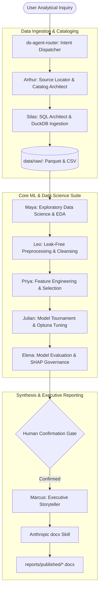

# ARIA: Autonomous Research Intelligence for Analytics 🎼

[](https://www.python.org/downloads/)
[](https://duckdb.org/)
[](https://github.com/anthropics/skills/tree/main/skills/docx)
[](LICENSE)

**ARIA (Autonomous Research Intelligence for Analytics)** — also known as **Orchestra** — is an open-source, **BYOA (Bring-Your-Own-Agent)** Data Science & Machine Learning intelligence framework. 

ARIA eliminates external LLM API-key dependencies, heavyweight orchestration frameworks, and web server bloat. Instead, it organizes the complete analytical lifecycle into **8 specialized world-class agent skills** that run directly within frontier coding environments (Google Antigravity, Claude Code, Cursor) using local scientific Python and **DuckDB**.

---

## 🏛️ System Architecture



---

## 👥 The 8 World-Class Agent Personas

Each agent persona is modeled after the pioneers who established the foundations of data science, statistics, software engineering, and visual communication:

| Agent | Historical Inspiration | Skill Directory | Core Mission |
|---|---|---|---|
| **Alfred** | **Alfred Pennyworth & JARVIS** | `.agents/skills/ds-agent-concierge-alfred/` | Loyal chief concierge, companion & major-domo. Handles casual requests and orchestrates technical agents. |
| **Arthur** | **Ralph Kimball** *(Dimensional Modeling)* | `.agents/skills/ds-agent-source-locator/` | Remote source discovery, cataloging schemas, mapping ER models. |
| **Silas** | **Joe Celko** *(SQL for Smarties)* | `.agents/skills/ds-agent-sql-query-engineer/` | Writing CTE-driven, zero-leakage SQL queries and executing columnar extracts via DuckDB. |
| **Maya** | **John Tukey & Florence Nightingale** | `.agents/skills/ds-agent-data-understanding/` | Deep exploratory data analysis, skewness, VIF checks, and visual distribution profiling. |
| **Leo** | **W. Edwards Deming** *(Quality Control)* | `.agents/skills/ds-agent-data-cleaning/` | Building leak-free preprocessing pipelines, MICE imputation, Winsorization, and clean train/test splits. |
| **Priya** | **Kaggle Grandmasters** | `.agents/skills/ds-agent-feature-engineering/` | Signal extraction, cyclical date encodings, interaction terms, and mutual information selection. |
| **Julian** | **Leo Breiman & Tianqi Chen** | `.agents/skills/ds-agent-model-building/` | Model tournament benchmarking (RF, LightGBM, XGBoost) and Bayesian Optuna hyperparameter tuning. |
| **Elena** | **Cynthia Rudin & Scott Lundberg** | `.agents/skills/ds-agent-model-evaluation/` | Cynical auditing, calibration curves, PR-AUC, cohort bias slicing, and exact TreeSHAP explanations. |
| **Marcus** | **Edward Tufte & Barbara Minto** | `.agents/skills/ds-agent-storytelling/` | Executive storytelling, narrative synthesis, and compiling publication-grade Word (`.docx`) reports. |

In addition, **`ds-agent-router`** routes user queries dynamically to the right specialist, and **`ds-agent-pipeline`** coordinates end-to-end runs.

---

## 📑 Anthropic DOCX Skill Integration

Reports generated by ARIA follow the official **Anthropic DOCX** standard:
- **Geometry:** 1-inch margins (1440 dxa) on all sides.
- **Palette:** Curated Corporate Navy palette (`#1F4E79`, `#2B6CB0`, `#D99B26`, `#2D3748`) with cool-gray alternating table shading (`#F8F9FA`).
- **Breakouts:** Professional single-cell callout boxes with thick 4.5pt left accent borders for executive summaries and verdicts.
- **Tables:** Explicit column widths enforced on every cell (`tcPr/w`), padding (`top=90 dxa`, `left=120 dxa`), `cantSplit` protection against orphan rows, and `tblHeader` on header rows.
- **Figures:** 300 DPI high-resolution figures embedded centered with numbered, italicized captions.

---

## 🔬 Validated Case Studies & Reproductions

### 1. Pulse Database Remote Discovery & Performance Audit
* **Target System:** Live remote MongoDB Atlas cluster (`pulse_db`).
* **Ingestion:** Arthur mapped 3 collections (`users` [34 accounts], `dailylogs` [85 entries], `predictions` [86 ML scores]); Silas extracted to Parquet and CSV.
* **Findings:**
  * Active cohort average productivity: **81.4 / 100**.
  * Longitudinal benchmark: Top contributor maintained a **22-day streak** with **90.6 avg productivity** supported by a healthy 7.6h sleep and 4.5h study routine.
  * Vulnerability cluster: Users with acute sleep deprivation (<5.0h) and high screen time (>6.5h) exhibited **High Burnout Risk** and maximum stress ratings (5.0/5.0).
* **Published Deliverable:** [`demonstration/pulse_analytics/reports/Sample_Pulse_Performance_and_Behavioral_Audit_Report.docx`](demonstration/pulse_analytics/reports/Sample_Pulse_Performance_and_Behavioral_Audit_Report.docx) (`489 KB`).

### 2. Amazon Product Rating Machine Learning Pipeline
* **Target Dataset:** Amazon E-Commerce catalog (`1,465 products` across 5 categories).
* **Holdout Performance:** Tuned Random Forest achieved holdout **RMSE = 0.2562**, with **75.4% of predictions within $\pm 0.25$ rating points**.
* **Governance Audit:** Elena verified zero data leakage and confirmed discount percentage and review volume as top SHAP drivers.
* **Published Deliverable:** [`demonstration/amazon_product_rating/reports/Amazon_Product_Rating_Analysis_Report.docx`](demonstration/amazon_product_rating/reports/Amazon_Product_Rating_Analysis_Report.docx) (`433 KB`).

---

## 📂 Repository Directory Layout

```
ARIA/
├── alfred.py               # 🎩 The Front Door (Interactive terminal concierge)
├── AGENTS.md               # 🧠 Alfred's Identity & Auto-Connection Rules
├── GEMINI.md               # 🧠 IDE AI Rules
├── .agents/                # ⚙️ Workspace Engine (Auto-detected by AI IDEs)
│   ├── skills/             # The 10 world-class agent skills + Anthropic docx
│   └── rules/              # Workspace instruction rules
├── demonstration/          # 📦 Isolated Demo Showcase (Pulse DB & Amazon ML)
│   ├── pulse_analytics/    # Remote discovery & behavioral audit demo
│   └── amazon_product_rating/ # End-to-end 8-stage ML pipeline demo
├── docs/                   # 📖 System Architecture & Agent Specifications
│   ├── ARCHITECTURE.md
│   └── AGENT_SUITE.md
├── requirements.txt        # ⚡ Ultra-lean dependencies (only 4 core packages)
├── .env.example            # Configuration template
└── README.md
```

---

## ⚡ Quickstart & Connecting with Alfred

### 1. Cloning the Repository

You can clone ARIA in either of two ways:

#### **Option A: Clone Directly into Current Directory (No Nested Folders - Recommended)**
If you are already inside your desired project directory:
```bash
git clone https://github.com/Master768/ARIA.git .
```
*(Notice the trailing **space and dot `.`** — this places the files directly into your current directory rather than creating a nested folder).*

#### **Option B: Standard Clone into `ARIA/` Subfolder**
```bash
git clone https://github.com/Master768/ARIA.git
cd ARIA
```

> [!IMPORTANT]
> **For IDE Users (Antigravity / VS Code / Cursor):**
> Ensure you open the **`ARIA` directory directly** (`File ➔ Open Folder... ➔ ARIA`). 
> The AI automatically reads [`AGENTS.md`](AGENTS.md) and [`.agents/`](.agents/) at the workspace root to connect with Alfred on prompt #1. If you open a parent directory containing `ARIA`, the AI will not be able to find Alfred's rules!

---

### 2. Connect with Alfred Immediately

#### **Method 1: Inside your AI IDE**
Open the cloned folder in Antigravity or your AI editor. Start a new chat and say:
> *"Hi"* or *"Alfred, what's our status?"*

Alfred will greet you in character, ready to coordinate the technical data science specialists.

#### **Method 2: Directly in Terminal (Zero Setup)**
Run:
```bash
python alfred.py
```
Alfred appears in the terminal with interactive options to initialize a clean workspace, inspect agents, or run demonstrations.

---

### 3. Setup Dependencies

```bash
python -m venv venv
# On Windows:
.\venv\Scripts\activate
# On Linux/macOS:
source venv/bin/activate

# Install core dependencies (Ultra-lean: only 4 essential packages, < 40 MB)
pip install -r requirements.txt
```

### 3. Configure Environment
Copy `.env.example` to `.env` (optional, for remote database connections):
```bash
cp .env.example .env
```

### 4. Run Demonstrations
* **Run Remote Discovery & Extraction (Arthur & Silas):**
  ```bash
  python demonstration/pulse_analytics/scripts/arthur_mongo_discovery.py "<MONGO_URI>"
  ```
* **Run User Performance Analytics (Silas & DuckDB):**
  ```bash
  python demonstration/pulse_analytics/scripts/analyze_user_performance.py
  ```
* **Compile Sample Word Report (Marcus):**
  ```bash
  python demonstration/pulse_analytics/scripts/generate_pulse_docx_report.py
  ```
* **Run Amazon E2E ML Benchmark (Julian & Elena):**
  ```bash
  python demonstration/amazon_product_rating/scripts/train_models.py
  python demonstration/amazon_product_rating/scripts/evaluate_model.py
  python demonstration/amazon_product_rating/scripts/generate_docx_report.py
  ```

---

## 🛡️ License

This project is licensed under the [MIT License](LICENSE).
