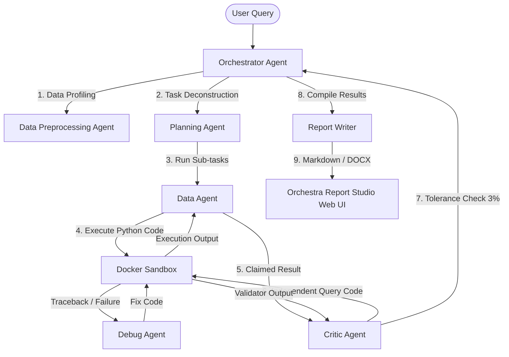

# ARIA: Autonomous Research Intelligence for Analytics 📊

**ARIA (Autonomous Research Intelligence for Analytics)** is an enterprise-grade, multi-agent AI framework built to automate data analysis pipelines. Using a double-entry validation pattern (Data Agent + Critic Agent), ARIA planning and execution flows ensure 100% mathematical correctness, eliminating hallucinations in data reporting. 

Review, edit, and sign off on generated markdown reports directly in the companion web application: **Orchestra Report Studio**.

---

## 🚀 Key Features

*   **Multi-Agent Coordination**: Guided by a master `OrchestratorAgent` that plans queries into sequential, verify-able analytical sub-tasks.
*   **Independent Double-Check Validation**: Each analytical step is computed by the `DataAgent` and independently validated by the `CriticAgent` via separate sandbox scripts. Any statistical or numeric drift triggers immediate self-correction.
*   **Robust Local & API Inference**:
    *   **Groq API Key Rotation**: Automatically rotates through a pool of Groq API keys to prevent rate limits (`429` errors).
    *   **Ollama Model Fallback & Pool**: Supports offline execution via a local Ollama model pool (rotating model configurations on failures or empty outputs).
*   **Automatic Error Correction**: Integrates a `DebugAgent` to auto-repair sandbox execution tracebacks (syntax errors, missing libraries, type exceptions).
*   **Relevance-Based File Selection**: Dynamically scores and picks the most relevant dataset file using token overlaps, synonym mappings, and column schemas.
*   **Prompt Sanitization**: Protects local tokenizers against crashes caused by unsupported symbols (e.g. Indian Rupee `₹`, unicode emojis, non-ASCII quotes) by mapping them to clean ASCII representations.
*   **Secure Sandboxed Runtime**: Runs generated python code safely in a Docker container or sandbox file environment.

---

## 🏛️ Multi-Agent Architecture



*   **Orchestrator Agent**: Manages the life cycle of the analysis, runs pre-profiling data checks, plans sub-tasks, coordinates agent data sharing, and aggregates final drafts.
*   **Data Agent**: Understands dataset schemas and generates the python/pandas scripts required to compute target answers.
*   **Critic Agent**: The gatekeeper of correctness. Receives the same sub-task prompt but is blind to the Data Agent's code. It generates its own verification script and validates the Data Agent's output against its findings (using a 3% tolerance gate).
*   **Debug Agent**: Acts as an inline debugger. If code run in the sandbox fails, it parses stderr and outputs corrected code.

---

## 📂 Repository Structure

```
Orchestra/
│
├── agents/                     # Core Agent Implementations
│   ├── orchestrator.py         # Orchestrator & Task Planner
│   ├── data_agent.py           # Pandas Code Generator
│   ├── critic_agent.py         # Verification & Numeric Validator
│   ├── debug_agent.py          # Auto-Repair & Debugging Code
│   ├── preprocessing_agent.py  # Data Profiling & Quality gate (EDA)
│   ├── report_writer.py        # DOCX & Markdown Publisher
│   └── llm_client.py           # Shared Client w/ Key Rotation & Ollama Fallback
│
├── config/                     # Configuration and Task State
│   └── task_state.json         # State Ledger tracking agent execution
│
├── data/                       # Local Datasets (e.g., CSV files)
│   ├── Binance_BTCUSDT_1h.csv  # Historical Bitcoin Price Data
│   └── amazon.csv              # Amazon India Customer Reviews
│
├── reports/                    # Generated Draft and Final Reports
│   └── manifest.json           # Catalog of generated reports
│
├── sandbox/                    # Safe runtime environment
│   └── Dockerfile              # Docker sandbox builder
│
├── tests/                      # Pytest unit tests
│   ├── test_orchestration.py
│   ├── test_validation.py
│   └── ...
│
├── streamlit_app.py            # Orchestra Report Studio dashboard
├── groq_api_keys.txt           # Groq API key rotation pool
└── requirements.txt            # Python dependencies
```

---

## 🔧 Installation & Setup

### 1. Clone the Repository
```bash
git clone https://github.com/Master768/ARIA.git
cd ARIA
```

### 2. Set Up Environment
Create a virtual environment and install dependencies:
```bash
python -m venv venv
venv\Scripts\activate   # On Windows
source venv/bin/activate # On Unix/macOS
pip install -r requirements.txt
```

### 3. API & Model Configuration
Create a `.env` file in the root directory:
```properties
# Models config
GROQ_MODEL=llama-3.3-70b-versatile
OLLAMA_MODEL=gpt-oss:20b-cloud
OLLAMA_MODELS=gpt-oss:20b-cloud

# Force local Ollama execution (offline mode)
USE_OLLAMA=true
USE_DOCKER=false
```

If using the **Groq API**:
- Add your API keys to `groq_api_keys.txt` (one key per line or using `KEY = value` format).
- Set `USE_OLLAMA=false` in `.env`.

---

## 🕹️ Running the Project

### Command Line Interface
To run the orchestrator directly from the command line:
```bash
python agents/orchestrator.py "What was the highest Bitcoin closing price in 2025?"
```

### Web Studio Dashboard
To launch the **Orchestra Report Studio** dashboard (where you can view Critic validation runs, edit drafts, and export reports to Markdown or Word):
```bash
streamlit run streamlit_app.py
```

### Running Tests
Ensure everything is correctly configured by executing the pytest test suite:
```bash
pytest tests/
```

---

## 🛡️ License
Distributed under the MIT License. See `LICENSE` for more information.
