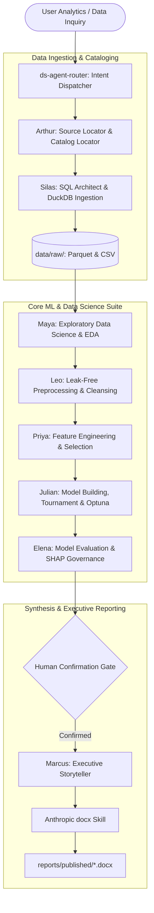

# ARIA / Orchestra System Architecture & Technical Spine

## 1. Architectural Philosophy: Bring-Your-Own-Agent (BYOA)

Traditional multi-agent frameworks often suffer from heavy abstractions, fragile API-key dependencies, vendor lock-in, and sprawling web server bloat. **ARIA (Autonomous Research Intelligence for Analytics)** / **Orchestra** is engineered around a lean, open-source **BYOA (Bring-Your-Own-Agent)** architecture:

1. **Zero External API Dependencies:** The host agentic environment (Google Antigravity, Claude Code, Cursor) provides the frontier reasoning engine, file system tools, and terminal sandbox. No external OpenAI or Anthropic API keys are required to execute analysis.
2. **Deterministic Data Engine:** Relational joins, schema discoveries, and analytical extractions run through **DuckDB**, an embeddable analytical columnar database, avoiding heavyweight database servers.
3. **Strict Invariant Spine:** Architectural invariants guarantee zero data leakage between train/test splits, mandatory human-in-the-loop report confirmation gates, and publication-grade Word `.docx` compilation via the Anthropic DOCX standard.

---

## 2. End-to-End Multi-Agent Lifecycle



---

## 3. Core Architectural Invariants

### Invariant 1: The Leak-Free Guarantee
* Train/test splitting **must** occur before computing any preprocessing artifacts (imputation medians, standard scalers, target encodings).
* Out-of-fold (OOF) feature creation must never allow test fold data to influence training parameters.
* Test partitions remain quarantined until Elena conducts final holdout evaluation.

### Invariant 2: Human-in-the-Loop Confirmation Gate
* No final Word (`.docx`) report is compiled until the user has reviewed the diagnostic metrics, preview figures, and statistical summaries in chat and provided explicit authorization.

### Invariant 3: Anthropic DOCX Typographic Standards
* Every published document must follow the official Anthropic DOCX specification:
  - 1-inch margins (1440 dxa) throughout.
  - Curated, purpose-driven color palettes (no default Word styles or generic colors).
  - Explicit column widths enforced on every cell (`tcPr/w`), with `cantSplit` protection and `tblHeader`.
  - Single-cell boxed breakout callouts with 4.5pt (36 sz) left accent borders.
  - Embedded high-resolution (300 DPI) visual charts centered with italicized captions.

### Invariant 4: Dual Serialization
* All extracted datasets must be serialized to both **CSV** (for immediate human inspection) and **Apache Parquet** (for high-speed columnar analytics in DuckDB).

---

## 4. Repository Directory Layout

```
Orchestra/
├── orchestra/
│   └── skills/                         # Portable, installable agent skills
│       ├── docx/                       # Cloned Anthropic DOCX compilation skill
│       ├── ds-agent-data-cleaning/
│       ├── ds-agent-data-understanding/
│       ├── ds-agent-feature-engineering/
│       ├── ds-agent-model-building/
│       ├── ds-agent-model-evaluation/
│       ├── ds-agent-pipeline/
│       ├── ds-agent-router/
│       ├── ds-agent-source-locator/
│       ├── ds-agent-sql-query-engineer/
│       └── ds-agent-storytelling/
├── demonstration/                      # Standalone, end-to-end demonstrations
│   ├── pulse_analytics/                # Remote discovery & behavioral audit demo
│   │   ├── data/                       # Synthetic sample data & schema manifests
│   │   ├── scripts/                    # Ingestion, DuckDB joins, and report compilers
│   │   ├── assets/                     # 300 DPI high-resolution figures
│   │   └── reports/                    # Sample publication-grade Word deliverable
│   └── amazon_product_rating/          # End-to-end 8-stage ML pipeline demo
│       ├── data/                       # Amazon catalog benchmark dataset
│       ├── scripts/                    # EDA, preprocessing, Optuna, evaluation scripts
│       ├── assets/                     # Diagnostic distribution & residual plots
│       └── reports/                    # Publication-grade Word deliverable
├── docs/
│   ├── ARCHITECTURE.md                 # Technical architecture & invariants
│   └── AGENT_SUITE.md                  # Full agent skill specifications
├── requirements.txt                    # Scientific Python dependencies
├── .env.example                        # Configuration template
└── README.md                           # Repository overview & quickstart
```
